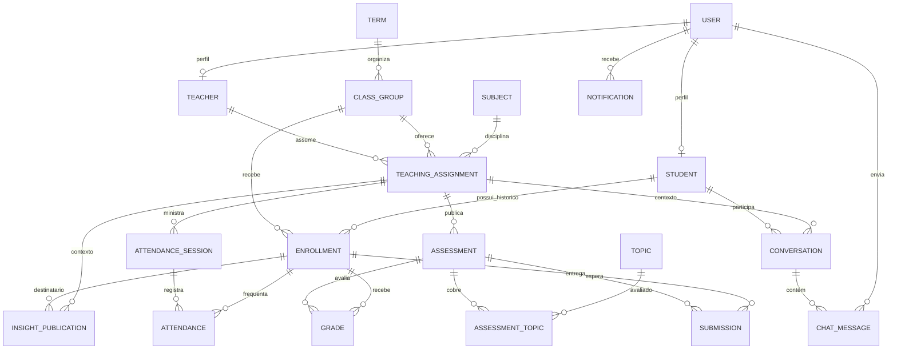

# Modelo de dados acadêmico

## Escopo e decisões

Django e suas migrações são a fonte do esquema. O banco guarda fatos acadêmicos e estado de publicação; médias, percentuais e contagens institucionais são consultas derivadas e não são duplicadas em tabelas de cache nesta etapa. Não há dados fictícios de alunos nem carga automática de turmas ou professores.

Há três perfis de uso: aluno, professor e coordenador. A conta técnica Django (`is_staff`/`is_superuser`) pertence à infraestrutura e não é um perfil acadêmico. O banco aplica um índice único parcial para permitir no máximo um coordenador. A existência de pelo menos um coordenador é garantida pelo procedimento de provisionamento e pela operação institucional; uma restrição relacional comum não consegue exigir que uma tabela tenha uma linha.

## Entidades e cardinalidades

| Entidade | Integridade e uso |
| --- | --- |
| `User` | Papel `student`, `teacher` ou `coordinator`; índice único parcial no papel coordenador. `Student` e `Teacher` têm relação 1:1 protegida. |
| `Term`, `ClassGroup`, `Subject` | Turma pertence ao período. `ClassGroup` não fixa uma disciplina: várias disciplinas e docentes podem ser associadas por atribuição. Capacidade é positiva e começa em 30. |
| `TeachingAssignment` | Liga professor, turma e disciplina. Unicidade por essa tripla; professor mantém uma conta e recebe uma atribuição para cada turma/disciplina. Quatro turmas por 11 disciplinas correspondem a até 44 atribuições, não 44 contas. |
| `Enrollment` | Vínculo estudante/turma com estado e datas, único por estudante/turma e protegido contra exclusão. A troca de turma cria outro vínculo e mantém o anterior. |
| `Assessment`, `Submission`, `Grade` | Atividade ligada à atribuição; submissão única por atividade/matrícula. A ausência de linha de submissão para uma matrícula ativa significa pendência. Nota é única por atividade/matrícula, tem feedback e só fica visível ao aluno quando `released_at` existe. |
| `AttendanceSession`, `Attendance` | Chamada ocorre em uma atribuição e data/hora; só sessão realizada e finalizada compõe o denominador. Há no máximo um registro por matrícula/sessão. Registros antigos sem contexto foram preservados em `Attendance` com data legada e não contam como frequência por disciplina até conciliação. |
| `Topic`, `AssessmentTopic` | Tópicos e competências ligados a uma disciplina e atividade tornam possível analisar conteúdo específico. Média geral sozinha não identifica defasagem de conteúdo. |
| `Conversation`, `ChatMessage` | Conversa única por aluno/atribuição, com participantes definidos como aluno e professor da atribuição. `read_at` registra a leitura pelo outro participante. Coordenador não recebe acesso implícito ao conteúdo. |
| `Notification` | Destinatário, categoria, título, resumo, estado de leitura, destino interno e referência textual ao objeto. Índice único parcial em destinatário/chave de deduplicação quando a chave não é vazia. |
| `InsightPublication` | Publicação ligada a aluno, atribuição e professor responsável; distingue rascunho, publicação ao aluno, uso interno institucional e retirada. Dados de origem preservados em JSON. |
| `InstitutionalPolicy` | Linha singleton com limiares e decisões de frequência configuráveis. Valores iniciais: 80% preventivo/abaixo de 75% crítico e 7,5 preventivo/7,0 crítico. |
| `AuditEvent` | Ator protegido, ação, objeto e detalhes JSON para alterações sensíveis; não há exclusão em cascata. A gravação transacional deve ser chamada pelos serviços de domínio. |

## Configuração inicial da escola

Após definir o período letivo e provisionar as identidades reais, criar quatro registros `ClassGroup`, cada um com capacidade 30, e estas 11 disciplinas com um professor individual por disciplina:

`Matemática`, `Português`, `Química`, `Biologia`, `Geografia`, `Física`, `História`, `Filosofia`, `Sociologia`, `Artes` e `Educação Física`.

Criar uma `TeachingAssignment` para cada combinação professor/disciplina/turma: 44 vínculos no arranjo inicial. O nome e código de período/turmas dependem dos dados institucionais e não foram inventados nem inseridos como registros. O banco não limita a 4 turmas, 11 professores ou 30 vagas por definição fixa; a capacidade inicial é um valor de cada turma e pode mudar para expansão futura.

## Regras de cálculo e alertas

| Sinal | Regra inicial | Fonte e deduplicação |
| --- | --- | --- |
| Frequência preventiva | Percentual menor ou igual a 80% e maior ou igual a 75%. | Sessões realizadas da atribuição. Chave sugerida: destinatário + `attendance_risk` + matrícula/disciplina/período + faixa. |
| Frequência crítica | Percentual estritamente abaixo de 75%. | Mesma fonte. Mudança de preventiva para crítica cria chave/faixa diferente. Ao sair do risco, emitir evento de resolução uma vez, não em toda consulta. |
| Desempenho preventivo | Média normalizada menor ou igual a 7,5 e maior que 7,0, numa escala final de 0 a 10. | Considerar somente notas liberadas. |
| Desempenho crítico | Média normalizada menor ou igual a 7,0. | Média ponderada: `10 × soma((nota / máximo_da_atividade) × peso) / soma(pesos)` sobre atividades com nota liberada. Nota inexistente não é zero. |
| Atividade publicada | Uma notificação por atividade e destinatário elegível ativo no instante da publicação. Rascunhos não notificam. | Chave por usuário + evento + atividade. |
| Mensagem, nota liberada, insight publicado | Notificar somente o destinatário autorizado quando a publicação/transição for confirmada. | Chave inclui o registro de origem. Mensagem não é copiada para o texto da notificação. |
| Alerta institucional | Sinal consolidado para acompanhamento do coordenador; não dá acesso ao texto de conversa privada. | Chave inclui contexto, período e estado/faixa. Não gerar alertas em renderizações/consultas. |

Frequência: percentual = presenças computáveis / sessões incluídas no denominador × 100. Só `AttendanceSession.status=held` participa. Canceladas e excluídas ficam fora. `InstitutionalPolicy` controla se atraso conta como presença (padrão: sim) e se falta justificada continua no denominador (padrão: sim; não entra no numerador). Sem sessões contabilizáveis, o percentual é indefinido e não dispara risco. Uma alteração posterior de política pode alterar o histórico calculado; registre a configuração vigente no evento de auditoria quando publicar relatórios oficiais.

Eventos e gravação de notificação devem ocorrer no mesmo serviço/transação da mudança acadêmica. A unique constraint em chave de dedupe torna repetição idempotente; a transição de faixa usa uma chave nova, e resolução usa categoria/estado próprios.

| Evento | Destinatário | Gatilho e chave sugerida |
| --- | --- | --- |
| `activity.published` | Alunos ativos da turma | Publicação confirmada; chave por aluno + atividade. Rascunho não gera evento. |
| `attendance.risk` | Aluno afetado e coordenador | Chamada finalizada altera a faixa; chave por destinatário + matrícula/disciplina/período + faixa. |
| `grade.risk` | Aluno afetado e coordenador | Nota liberada altera a faixa; média provisória não é exposta ao aluno. |
| `chat.message` | Outro participante da conversa | Mensagem confirmada; chave por destinatário + mensagem. A notificação não replica o texto privado. |
| `grade.released` | Aluno da matrícula | Nota/feedback liberado; chave por aluno + nota. Gravação ainda interna não notifica. |
| `insight.published` | Aluno destinatário | Publicação individual liberada; chave por aluno + publicação. Insight interno não aparece ao aluno. |
| `institutional.follow_up` | Coordenador | Situação que cruza critério institucional (pendências ou risco); chave por contexto + período + faixa/estado. Não gerar por acesso ao dashboard. |

Categorias ficam em texto para permitir novos eventos sem migração de schema. Serviços futuros devem criar destinatários e eventos dentro de transações, impedir duplicação via `dedupe_key`, registrar resolução ao sair do risco e não incluir dados privados no resumo.

## Permissões por perfil

| Ação | Aluno | Professor | Coordenador |
| --- | --- | --- | --- |
| Consultar matrícula, notas e frequência | Próprios registros; nota/feedback apenas liberados | Estudantes de suas atribuições | Consulta institucional ampla |
| Criar/publicar atividade, corrigir e registrar chamada | Não | Atribuições próprias | Mudanças só por regra explícita, com auditoria |
| Conversa privada | Suas conversas | Conversas das suas atribuições | Sem leitura implícita |
| Insight | Publicações liberadas para si | Publicar para atribuições próprias | Indicadores institucionais, inclusive internos |
| Notificação | Apenas destinatário autenticado | Apenas destinatário autenticado | Apenas destinatário autenticado |
| Administração técnica Django | Não | Não | Não; infraestrutura protegida separadamente |

A API deve filtrar querysets e validar o objeto no servidor. Chaves estrangeiras, IDs na URL e ocultação de controles no frontend não são autorização. O conjunto atual de endpoints é inicial: regras completas de gravação, autorização por objeto e transações de eventos permanecem pendentes para a fase de backend.

## Compatibilidade e limitações atuais

As migrações anteriores são preservadas. A migração para três papéis para com erro claro se encontrar qualquer papel `admin` legado ou mais de um coordenador. Revise as contas e atribua explicitamente um dos três perfis adequados antes de reaplicar; nenhuma conta é removida nem promovida automaticamente. O antigo vínculo turma/disciplina continua marcado como `legacy_subject`. Atividades antigas são associadas automaticamente apenas quando existe exatamente uma atribuição na turma; as demais ficam como rascunho legado até revisão. Frequência diária antiga mantém data e presença, sem inventar disciplina ou sessão. Notas anteriores sem autor permanecem com `recorded_by` nulo; lançamentos novos devem registrar o ator.

A capacidade é aplicada pelo serviço `enroll_student`, que bloqueia a linha da turma e conta matrículas ativas dentro da transação. Em PostgreSQL, pedidos concorrentes para uma mesma turma serializam nesse bloqueio. Toda criação de matrícula deve passar pelo serviço; gravar diretamente no ORM/SQL contorna o limite. As regras de publicação, eventos e notificações, filtros completos e auditoria transacional ainda requerem serviços de domínio e testes específicos antes de produção.

Serviços de domínio que ainda precisam ser conectados aos fluxos da API: criar atribuições e matrículas; criar expectativa/pendência de atividade por diferença entre matrículas ativas e entregas; validar publicações e liberar nota/feedback; finalizar chamadas antes do cálculo; criar conversas/mensagens após validar participantes; publicar insights; persistir notificações idempotentes e eventos de resolução; gravar `AuditEvent` junto a alterações de nota/chamada; e atualizar relatórios institucionais com filtros de permissão.
